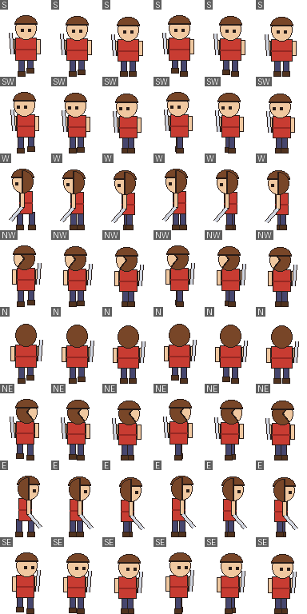

# Character sprites

Characters are 2D sprites in the 3D world, like in Ragnarok Online. Each sprite turns to face the camera but stays upright, and a soft round shadow sits on the ground under its feet.


## How it fits together

`scenes/actors/CharacterVisual.tscn` is the look of one character. Put an instance of it under any character body, at the feet. `Player.tscn` has one, named `Visual`.

| Node | Type | Role |
| --- | --- | --- |
| `CharacterVisual` | `Node3D` | Root, at the character's feet |
| `Sprite` | `AnimatedSprite3D` + `CharacterSprite` | The character. Billboard is **Y-Billboard**, so it turns around Y only and never leans back under the 45° camera |
| `BlobShadow` | `Decal` | A dark radial gradient projected down onto the ground. It follows slopes and ramps |

- `Ragna.Core.Characters.CharacterAnimator` (`scripts/core/Characters/`) has the rules. It has no Godot dependency and is tested in `tests/Ragna.Core.Tests/Characters/`.
- `CharacterSprite` (`scripts/gameplay/Characters/`) reads the speed of the nearest `CharacterBody3D` above it every frame. It plays `walk` above **Walk Speed Threshold** (0.1 m/s) and `idle` below it.
- It also picks one of eight directions every frame, so the sprite shows the side of the character the camera sees. See [8-direction facing](#8-direction-facing).
- Call `PlayAttack()` on the sprite to play `attack` once, from the first frame. It plays over idle and walk, then the sprite goes back to idle or walk. Nothing calls it yet; click-to-attack combat (GAM-10) will.

## 8-direction facing

The character faces the way it last walked. It keeps that facing when it stops. Call `Face(direction)` on the sprite to turn it, for example towards an attack target.

Every frame the sprite compares that facing with the active camera's look direction, both flattened onto the ground. The angle between them picks one of eight directions. Only the angle between them counts, so the drawn direction changes when the camera turns with **Q** / **E**, even if the character stands still.

| Row | Direction | Suffix | What the camera sees |
| --- | --- | --- | --- |
| 0 | South | `s` | The front: the character faces the camera |
| 1 | South-west | `sw` | Front, turned to the screen's left |
| 2 | West | `w` | Walking to the screen's left |
| 3 | North-west | `nw` | Back, turned to the screen's left |
| 4 | North | `n` | The back: the character faces away |
| 5 | North-east | `ne` | Back, turned to the screen's right |
| 6 | East | `e` | Walking to the screen's right |
| 7 | South-east | `se` | Front, turned to the screen's right |

Each direction covers 45°, centred on it. The math is `Ragna.Core.Characters.FacingDirections` (`scripts/core/Characters/FacingDirection.cs`), tested in `tests/Ragna.Core.Tests/Characters/FacingDirectionTests.cs`.

### Directional animations

For each animation, the sprite looks for a directional version in its `SpriteFrames`, in this order. The example is `walk` facing south-east:

1. `walk_se`, the exact direction.
2. `walk_sw`, the mirror image, drawn flipped left to right. A sheet with only the five directions `s`, `sw`, `w`, `nw` and `n` covers all eight.
3. `walk`, the plain animation, not flipped.

When the direction changes in the middle of an animation, the sprite keeps the current frame, so a walk cycle or an attack does not restart.

The placeholder art has all eight directions for every animation, so you can see the facing change in game. Each placeholder frame has its direction (`S`, `SW`, ...) written in the top-left corner.

## Sprite settings

| Setting | Value | Why |
| --- | --- | --- |
| Billboard | Y-Billboard | Faces the camera, stays upright |
| Pixel Size | 0.018 m | A 96 px frame is 1.73 m tall, the height of the player's collision capsule |
| Position | Y = 0.864 m | Half the sprite height, so the feet touch the ground |
| Shaded | Off | Sprites keep their own colours; the light doesn't darken them |
| Alpha Cut | Discard | Sorts correctly against other sprites and the terrain |
| Texture Filter | Nearest | Crisp pixel art |
| Cast Shadow | Off | The blob shadow replaces the real one |
| Layers | 2 | Keeps the blob shadow off the sprite (see below) |

## Blob shadow

The `BlobShadow` decal is 0.9 m wide and reaches 0.5 m above and below the feet. Its **Cull Mask** has every layer except layer 2, so it draws on the terrain but not on character sprites. Put new character sprites on render layer 2 too.

To change the shadow, edit the `Gradient` in `CharacterVisual.tscn`: the centre is 60 % black, and it fades to clear at the edge.

## Animations

The sprite's `SpriteFrames` must have these three animations:

| Name | Loops | Placeholder frames | Placeholder speed |
| --- | --- | --- | --- |
| `idle` | Yes | 4 | 4 fps |
| `walk` | Yes | 6 | 10 fps |
| `attack` | No | 4 | 10 fps |

`attack` must not loop: the sprite goes back to idle or walk when it ends.

Every animation also has eight directional versions, `idle_s` to `attack_se`. The plain names are the fallback for art without directions; see [Directional animations](#directional-animations).

## Sprite sheet layout

Follow this layout for all character art, so real sheets drop in without code changes. The rules are `Ragna.Core.Characters.SpriteSheetLayout` (`scripts/core/Characters/SpriteSheetLayout.cs`), tested in `tests/Ragna.Core.Tests/Characters/SpriteSheetLayoutTests.cs`.

| Rule | Value |
| --- | --- |
| Files | One PNG per animation: `<character>_<animation>.png`, for example `novice_walk.png` |
| Folder | `assets/characters/<character>/`, with the `SpriteFrames` as `<character>_frames.tres` |
| Frame size | 64 × 96 px, no padding or gaps between frames |
| Columns | One per frame, left to right in play order. Frame `i` starts at x = 64 × `i` |
| Rows | One per direction, in this order: `s`, `sw`, `w`, `nw`, `n`, `ne`, `e`, `se` (south first, then clockwise). Row `r` starts at y = 96 × `r` |
| Sheet size | (64 × frame count) × 768 px. Idle and attack are 256 × 768, walk is 384 × 768 |
| Anchor | Feet on the bottom pixel row (y = 95), centred (x = 32). The sprite node sits half a frame above the ground, so this anchor lands on the ground |
| Background | Transparent. Pixels are either opaque or fully clear: the sprite uses alpha cut |
| Animation names | `<animation>_<direction>`, for example `walk_se`, plus the plain `idle`, `walk` and `attack` |

The direction rows are the [8-direction facing](#8-direction-facing) rows: south faces the camera, west walks to the screen's left, north faces away.

### Five-direction art

Art with only the left-facing side can leave out `ne`, `e` and `se`. The sprite then draws `nw`, `w` and `sw` flipped. Leave those animations out of the `SpriteFrames` too; an empty row in the sheet is fine.

### Placeholder sheets

The placeholder is `assets/characters/placeholder/`:

| File | Contents |
| --- | --- |
| `placeholder_idle.png` | 4 frames × 8 directions, 4 fps, loops |
| `placeholder_walk.png` | 6 frames × 8 directions, 10 fps, loops |
| `placeholder_attack.png` | 4 frames × 8 directions, 10 fps, plays once |
| `placeholder_frames.tres` | The `SpriteFrames`: 24 directional animations, and the plain `idle`, `walk` and `attack` (the south row) |



The east-facing rows are the west-facing rows mirrored. Regenerate everything, including the `.import` files, with:

```sh
python3 tools/characters/make_placeholder_sprites.py   # needs Pillow
```

### Swapping in real art

1. Draw the sheets to the layout above and put them in `assets/characters/<character>/`.
2. Make a `SpriteFrames` named `<character>_frames.tres`. For each sheet, add the eight `<animation>_<direction>` animations, cutting each row into 64 × 96 frames (in the SpriteFrames editor, **Add frames from sprite sheet** with 8 vertical and N horizontal cells). Copy speed and looping from the placeholder.
3. Set it as **Sprite Frames** on the `Sprite` node in `CharacterVisual.tscn`, or on a copy of that scene for another character.

A different frame size works if every sheet of the character uses it. Then change **Pixel Size** so the frame height matches the character's height in metres, and set the `Sprite` node's Y to half that height.
