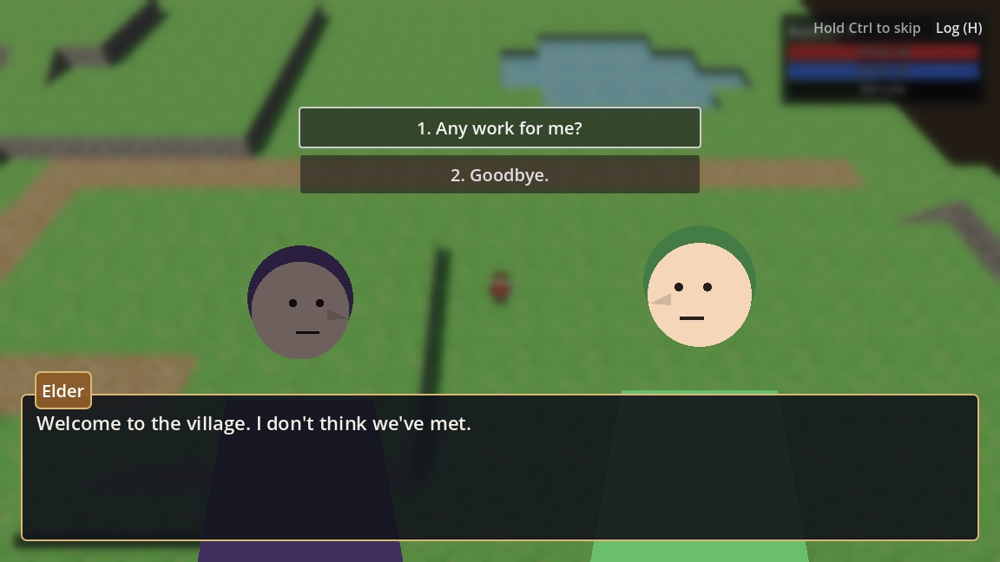
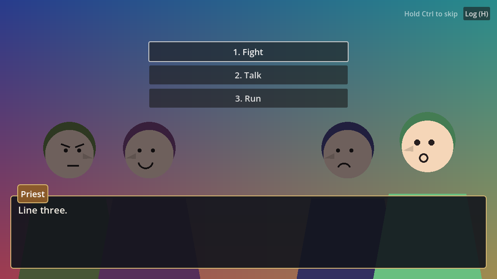

# Dialogue scripts

A dialogue scene is a JSON file in `data/dialogue/`. Adding a scene needs no code. [`data/dialogue/example.json`](../data/dialogue/example.json) shows every command.

This page covers the script format, the runner, the [dialogue scene UI](#the-dialogue-scene), [portrait art](#portrait-art) and how [NPCs and story triggers](#npcs-and-story-triggers) start a scene.

## File format

```json
{
  "id": "elder_intro",
  "commands": [
    { "cmd": "enter", "character": "elder", "slot": "right" },
    { "cmd": "say", "speaker": "elder", "text": "Welcome, traveller." }
  ]
}
```

- `id` must match the file name (`elder_intro.json`). A test checks this for every file.
- `//` comments and trailing commas are allowed.
- Misspelled fields, unknown commands and wrong types fail when the script loads. The message says where, for example `Dialogue commands[2].options[0].then[1] needs a "text".`

## Commands

| `cmd` | Fields | What it does |
| --- | --- | --- |
| `enter` | `character`, `slot`, optional `expression` (default `neutral`), optional `flip` (default `false`) | Puts a character on stage. If they are already on stage, they move. Whoever stood in that slot leaves. |
| `exit` | optional `character` | Takes the character off stage. With no `character`, everyone leaves. |
| `expression` | `character`, `expression` | Changes the portrait of a character on stage. |
| `say` | optional `speaker`, `text` | Shows a line and waits for a click. No `speaker` means narration. The speaker doesn't have to be on stage. |
| `choice` | `options`: a list of `{ "text", "then", "ifFlag", "ifValue" }` | Shows the options and waits for a pick. Runs that option's `then` commands, then carries on after the choice. An option with `ifFlag` only shows when that flag equals `ifValue` (default `true`). If no option shows, the choice is skipped. |
| `set_flag` | `flag`, optional `value` (default `true`) | Sets a [dialogue flag](save.md#dialogue-flags). Flags are saved with the game. |
| `if_flag` | `flag`, optional `value` (default `true`), optional `then`, optional `else` | Runs `then` if the flag equals `value`, otherwise `else`, then carries on. A flag that was never set is `false`. |
| `background` | optional `image` | Changes the background. No `image` clears it. |
| `wait` | `seconds` (0 or more) | Pauses. |
| `end` | | Ends the scene at once, even from inside a branch. |

`then` and `else` blocks can hold any commands, including more choices and branches.

**Slots**, left to right: `far_left`, `left`, `center`, `right`, `far_right`. Two-person scenes use `left` and `right`. Group scenes of four add `far_left` and `far_right`.

**Expressions**: `neutral`, `happy`, `angry`, `sad`, `surprised`. Any other name fails when the script loads.

**Facing**: portrait art faces right. Portraits in `right` and `far_right` are mirrored so they face the middle. `"flip": true` reverses that for one character.

**Choices**: the scene shows 2–3 options well. More options work but crowd the screen.

## Running a script

```csharp
var script = DialogueScript.FromJson(json);
var runner = new DialogueRunner(script, SaveService.Flags);

var next = runner.Advance();
```

`Advance` handles flags and branches itself and returns the next `DialogueEvent` for the UI:

| Event | The UI should |
| --- | --- |
| `CharacterEntered`, `CharacterExited`, `ExpressionChanged`, `BackgroundChanged` | Apply it and call `Advance` again (`Instant` is true) |
| `LineShown` | Show the line, call `Advance` on click |
| `WaitRequested` | Wait `Seconds`, then call `Advance` |
| `ChoiceShown` | Show `Options`, then call `Choose(index)` and `Advance`. The index counts only the options shown |
| `DialogueEnded` | Close the scene. `Advance` keeps returning it |

`runner.Stage` and `runner.Background` hold the current stage, for example to redraw it.

Calling `Advance` while a choice is waiting throws `InvalidOperationException`. Changing the expression of, or removing, a character who isn't on stage throws `InvalidDataException` naming the script.

## Pieces

| Piece | Where | What it does |
| --- | --- | --- |
| `DialogueScript` | `scripts/core/Dialogue/` | Reads and validates a script |
| `DialogueCommand` records | `scripts/core/Dialogue/DialogueCommand.cs` | One record per command |
| `DialogueRunner` | `scripts/core/Dialogue/` | Steps through a script, tracks the stage, reads and writes flags |
| `DialogueEvent` records | `scripts/core/Dialogue/DialogueEvent.cs` | What the UI should do next |
| `DialogueSession` | `scripts/core/Dialogue/` | Drives a runner for the scene UI: typewriter, waits, skip, choices, history |
| `Typewriter`, `DialogueHistory`, `StageSlots`, `Expressions`, `SpeakerNames` | `scripts/core/Dialogue/` | Text reveal, the history log, slot positions and facing, the known expressions, name plate text |
| `DialogueScene` | `scripts/dialogue/DialogueScene.cs`, `scenes/ui/DialogueScene.tscn` | The full-screen scene UI (Godot) |
| `PortraitView` | `scripts/dialogue/PortraitView.cs` | One bust portrait (Godot) |

Everything under `scripts/core/` has no Godot dependency and is tested in `tests/Ragna.Core.Tests/Dialogue/`.

## The dialogue scene



`DialogueScene` is a full-screen `CanvasLayer` (layer 10) in `Main.tscn`. While a scene plays, the world is paused and the scene swallows all input.

```csharp
DialogueScene.Instance?.Play("elder_intro");   // data/dialogue/elder_intro.json
DialogueScene.Instance!.Finished += id => GD.Print($"{id} is over");
```

`Play(DialogueScript)` plays a script that is already loaded. Flags go to `SaveService.Flags`, so they are saved with the game.

| Input | What it does |
| --- | --- |
| Click or **Enter** | Shows the whole line if it is still typing, otherwise moves on |
| Hold **Ctrl** | Skips lines and waits, stopping at the next choice |
| **1**–**3**, or click | Picks a choice |
| **H**, or the Log button | Opens or closes the history log (**Esc** closes it too) |
| **F8** | Plays `data/dialogue/example.json`, to try the scene out (set `DebugScriptId` to empty to turn it off) |

What it shows:

- **Portraits.** Busts stand along the bottom of the screen in their slot. The speaker shows at full brightness and size; everyone else is dimmed and slightly smaller. During narration everyone is dimmed. Portraits slide and fade in from their side of the screen, and out again.
- **Portrait art.** `res://assets/portraits/<character>/<expression>.png`, for example `assets/portraits/elder/happy.png`. A missing expression falls back to the character's `neutral.png`. A character with no art yet gets a drawn placeholder bust with a simple face for each expression. See [Portrait art](#portrait-art) for the size and anchor.
- **Text box.** Along the bottom, with the speaker's name on a plate above it. The name is the character id in title case (`old_man` shows as `Old Man`). Narration has no plate and lighter text. A blinking ▼ means the line is complete.
- **Typewriter.** `CharactersPerSecond` on the node (default 40; 0 shows lines at once).
- **Background.** With no `background`, the world shows dimmed and blurred (`assets/shaders/dialogue_blur.gdshader`). `"image"` shows a full-screen image instead: a `res://` path, or a name in `res://assets/backgrounds/` (`"village"` is `village.png`). An image that can't be found logs a warning and shows the world.



A group of four over a full-screen image, made with a test script. The mage on the left uses `"flip": true`.

## Portrait art

Each character has a folder of bust portraits, one PNG per expression:

```
assets/portraits/<character>/<expression>.png
assets/portraits/elder/neutral.png
assets/portraits/elder/happy.png
```

| Rule | Value |
| --- | --- |
| Character folder | The character id used in scripts: lower case letters, digits and `_` (`old_man`) |
| File name | One of the [expressions](#commands): `neutral`, `happy`, `angry`, `sad`, `surprised` |
| Required | `neutral.png`. Any other missing expression shows `neutral.png` |
| Size | **300 x 440 px** (`PortraitArt.Width` x `PortraitArt.Height`, the default `DialogueScene.PortraitSize`). Other sizes are scaled to fit, keeping their aspect |
| Background | Transparent |
| Facing | Facing **right**. Portraits in the `right` and `far_right` slots are mirrored |
| Anchor | **Bottom centre.** The bottom pixel row stands on the bottom edge of the screen, centred on the slot. Draw the bust down to the bottom edge, with the head in the top half |

The placeholder busts for `elder` and `hero` are drawn by `tools/portraits/make_placeholder_portraits.py` (needs Pillow). Add a character to `CHARACTERS` in that script and run it again, or replace the PNGs with real art of the same size. A test (`PortraitArtTests`) checks every file's name and size, and that every character in `data/dialogue/` has a `neutral.png`.

Godot imports new PNGs when the editor next opens the project.

## NPCs and story triggers

Two things in the world start a dialogue scene.

**NPCs.** `scenes/actors/Npc.tscn` is a character the player can talk to. Left-click it: the player walks over, the two turn to face each other, and its scene plays. Set on the node:

| Property | What it does |
| --- | --- |
| `DialogueId` | The script to play, `data/dialogue/<DialogueId>.json` |
| `DisplayName` | Name shown above its head |
| `Tint` | Colour for the placeholder sprite |

NPCs sit on the `npcs` physics layer (layer 5). Talking is handled by `PlayerTalk`, a child of the player after `Pickup`. Clicking the ground, a monster or an item cancels the walk to an NPC; clicking an NPC cancels walking to an item or attacking.

**Story triggers.** `scenes/triggers/StoryTrigger.tscn` is an `Area3D` (a 4 x 2 x 4 m box; resize its `Collision` shape) that plays a scene when the player walks in. The player stops walking.

| Property | Default | What it does |
| --- | --- | --- |
| `DialogueId` | | The script to play |
| `Once` | `true` | Play only once per game |
| `OnceFlag` | `trigger.<DialogueId>` | The [dialogue flag](save.md#dialogue-flags) that remembers it played. It is saved, so a played trigger stays played after a load |
| `RequiredFlag`, `RequiredValue` | none, `true` | Only play once that flag equals the value, for example after a talk set it |

The rules live in `StoryTriggerRule` (`scripts/core/Dialogue/`).

### On the test map

| What | Where | Script |
| --- | --- | --- |
| The Village Elder (NPC) | (26, 0, 21), a few metres from where the player starts | [`elder_greeting.json`](../data/dialogue/elder_greeting.json) |
| Village arrival (story trigger, once) | (20, 0, 19), on the dirt path past the elder | [`village_arrival.json`](../data/dialogue/village_arrival.json) |

`elder_greeting` is the sample conversation: the elder and the hero, with expression changes, and a choice that sets `promised_help` to `true` or `false`. Talk to the elder again and they remember: after a promise they thank you; after a refusal they skip the introduction and ask again. Save with **F5**, load with **F9**, and the flag comes back with the save. `SampleConversationTests` plays both choices through a save and load.
