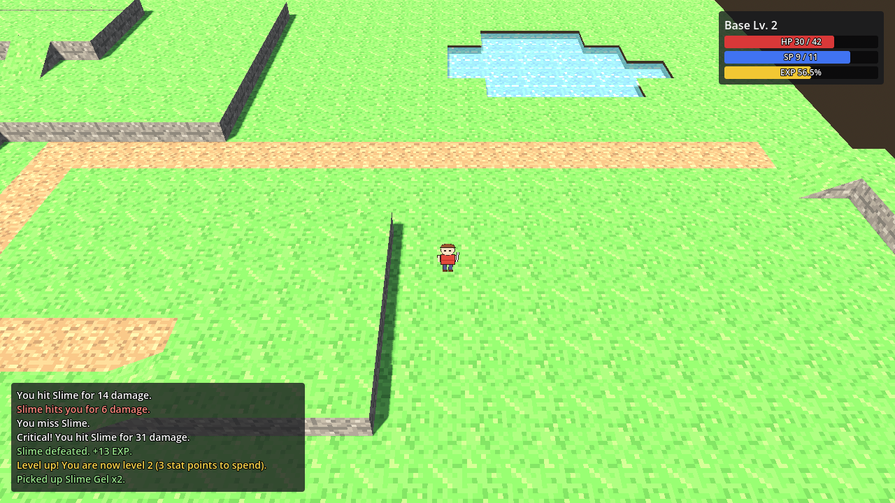

# HUD

The HUD shows the player's level and HP, SP and EXP bars in the top-right corner, and a message log in the bottom-left corner.

The wording and bar values live in `Ragna.Core.Hud` (`scripts/core/Hud/`), with no Godot dependency, and are tested in `tests/Ragna.Core.Tests/Hud/`.

| Piece | Where | What it does |
| --- | --- | --- |
| `MessageLog`, `LogMessage` | core | The last 50 messages, oldest first, each with a `MessageKind`. Raises `Added` |
| `HudMessages` | core | The text of every logged message (damage, misses, crits, kills and EXP, loot, level-up, death) |
| `BarReading` | core | What a bar shows: how full it is and its caption, for HP, SP and EXP |
| `SpPool` | core | Current and max SP. Max SP can be 0. Skills will spend it |
| `Hud` | `scripts/ui/`, `scenes/ui/Hud.tscn`, under `UI` in `Main.tscn` | Builds the bars and the log. `Player` points at `Player/Combat`, `Pickup` at `Player/Pickup` |
| `HudBar` | `scripts/ui/` | One coloured bar with its caption |

## Events

The HUD never polls. It updates from these events:

| Event | Updates |
| --- | --- |
| `Health.Changed` | HP bar |
| `SpPool.Changed` | SP bar |
| `CharacterStats.ExpChanged` | EXP bar and level |
| `CharacterStats.LevelledUp` | Log: level up |
| `PlayerCombat.AttackMade` | Log: you hit / miss / crit |
| `PlayerCombat.Attacked` | Log: a monster hits / misses you |
| `PlayerCombat.Killed` | Log: monster defeated, +EXP |
| `PlayerCombat.Died`, `Revived` | Log: defeated by, back on your feet |
| `PlayerPickup.PickedUp` | Log: picked up an item |

Other nodes can write to the log with `Hud.Post(kind, text)`.

## Bars

- **HP** and **SP** read `current / max`. Max HP and SP follow the player's stats, so they grow on level-up. Dying and coming back refills both.
- **EXP** reads progress towards the next level as a percentage, like Ragnarok. It rounds down, so it never shows `100.0%` before the level-up. At max level it reads `EXP MAX` and stays full.

## Log colours

| Kind | Colour |
| --- | --- |
| Damage dealt | White |
| Damage taken | Red |
| Loot (kills, EXP, items) | Green |
| Level up | Gold |
| System | Grey |

The log shows the newest 8 lines (`VisibleLines` on the `Hud` node). The HUD ignores the mouse, so clicks go through it to the world.
