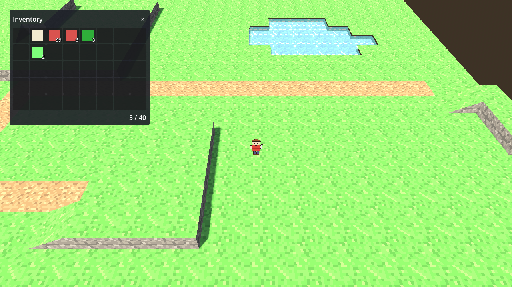

# Inventory

The player has a grid inventory of 8 × 5 slots. Items you pick up go into it. Press **I** to open or close the inventory window.

The rules live in `Ragna.Core.Items.Inventory` (`scripts/core/Items/Inventory.cs`), with no Godot dependency, and are tested in `tests/Ragna.Core.Tests/Items/InventoryTests.cs`.

| Piece | Where | What it does |
| --- | --- | --- |
| `Inventory`, `ItemStack` | core | The slot grid: add, stack, remove, move, and how much room is left |
| `PlayerInventory` | `scripts/gameplay/Items/`, the `Inventory` node in `Player.tscn` | Holds the player's `Inventory`. Set `Columns` and `Rows` on the node |
| `InventoryWindow` | `scripts/ui/`, `scenes/ui/InventoryWindow.tscn`, under `UI` in `Main.tscn` | The window. Its `Source` points at the player's `Inventory` node |
| `InventorySlotView` | `scripts/ui/` | One slot in the window |

## Rules

- Each slot is empty or holds one stack of one item type.
- A stack holds up to the item's `maxStack` (99 by default, set in `data/items/items.json`). An item with `maxStack` 1 doesn't stack.
- Slots are numbered row by row from the top left, starting at 0.
- **Add** fills stacks of the same item first, then empty slots in order. If not everything fits, `Add` returns how many are left over. `TryAddAll` adds all of them or none.
- **Remove** takes from the last stacks of that item first, so the first stacks stay full. It returns how many it took.
- **Full**: `IsFull` means no slot is empty. A full inventory still takes more of an item whose stack has room. `SpaceFor(item)` says exactly how many more fit.
- **Move** (dragging in the window): onto an empty slot it moves the stack; onto the same item it merges as much as fits and leaves the rest; onto a different item the two swap.
- Item ids match ignoring case, as in `ItemDatabase`.

## Picking up

When the player reaches a clicked item, `PlayerPickup` checks that the whole stack fits. If it does, the item goes into the inventory. If it doesn't, the item stays on the ground and the log says `Inventory is full: Slime Gel x2 stays on the ground.`

## The window

- **I** opens and closes it. The `×` button closes it.
- Drag the title bar to move the window.
- Drag a slot onto another slot to move, merge or swap.
- Hover a slot to see the item's name, quantity and description.
- The footer shows used slots out of the total.
- Each item shows as a square in its `tint` colour until there are item icons. Stacks above 1 show their quantity.

The window takes the mouse clicks over it, so clicking it doesn't move the player.
